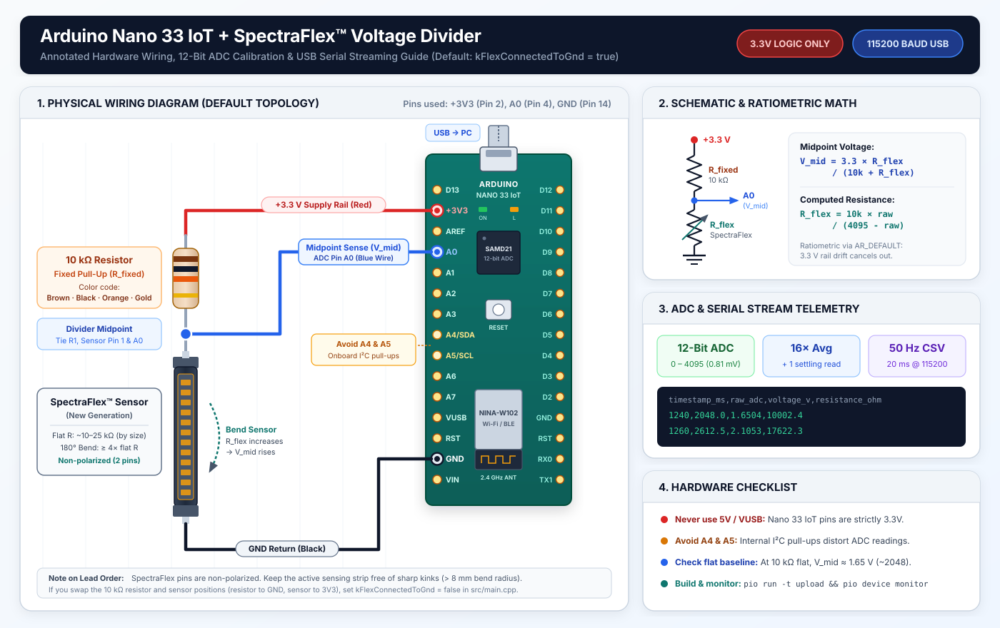

# Arduino Nano 33 IoT — SpectraFlex ADC Streamer

PlatformIO firmware for reading a **SpectraFlex (new generation)** flex sensor in a voltage divider with a **10 kΩ** resistor on an **Arduino Nano 33 IoT** (`SAMD21G18A`) and streaming 12-bit ADC measurements over USB Serial.

## Wiring



The Nano 33 IoT operates strictly at **3.3 V** (never connect 5 V to any pin).  
Default analog pin: **`A0`** (avoid `A4`/`A5` as they share the I²C bus and have onboard pull-up resistors).

### Option A (Default: `kFlexConnectedToGnd = true`)
Voltage rises as the sensor bends:
```text
3V3 ----[ 10 kΩ ]----+----[ SpectraFlex ]---- GND
                     |
                    A0
```

### Option B (`kFlexConnectedToGnd = false`)
Voltage drops as the sensor bends (set `kFlexConnectedToGnd = false` in `src/main.cpp`):
```text
3V3 ----[ SpectraFlex ]----+----[ 10 kΩ ]---- GND
                           |
                          A0
```

## Firmware Details

- **ADC Resolution:** 12-bit (`0`–`4095`) using `AR_DEFAULT` (3.3 V ratiometric reference).
- **Oversampling:** 16 reads averaged per output sample (with a dummy settling read first).
- **Sample Rate:** 50 Hz (`20 ms` interval, configurable via `kSampleIntervalMs`).
- **Serial Format:** CSV at `115200` baud over native USB CDC:
  ```text
  timestamp_ms,raw_adc,voltage_v,resistance_ohm
  1240,2048.0,1.6504,10002.4
  ```
- **SpectraFlex Notes:** New-generation SpectraFlex sensors typically have ~10–25 kΩ flat resistance (depending on 55 mm vs. 95 mm length) and increase in resistance when bent. Because the Nano 33 IoT uses `VCC` (3.3 V) as the ADC reference, the resistance calculation is ratiometric and insensitive to small regulator drift.

## Build, Upload & Monitor

```bash
# Build firmware
pio run

# Upload to connected Arduino Nano 33 IoT
pio run -t upload

# Stream serial output
pio device monitor
```

## Python Reader

Create/activate the local `.venv` and install dependencies from `requirements.txt`:

```bash
python3 -m venv .venv
source .venv/bin/activate
pip install -r requirements.txt
```

Run the reader script (auto-detects the Nano 33 IoT port):

```bash
# Formatted live table
.venv/bin/python scripts/read_serial.py

# Log samples to a CSV file
.venv/bin/python scripts/read_serial.py --out recordings/flex.csv

# Output raw CSV to stdout (optional --port and --count)
.venv/bin/python scripts/read_serial.py --raw --count 100
```
